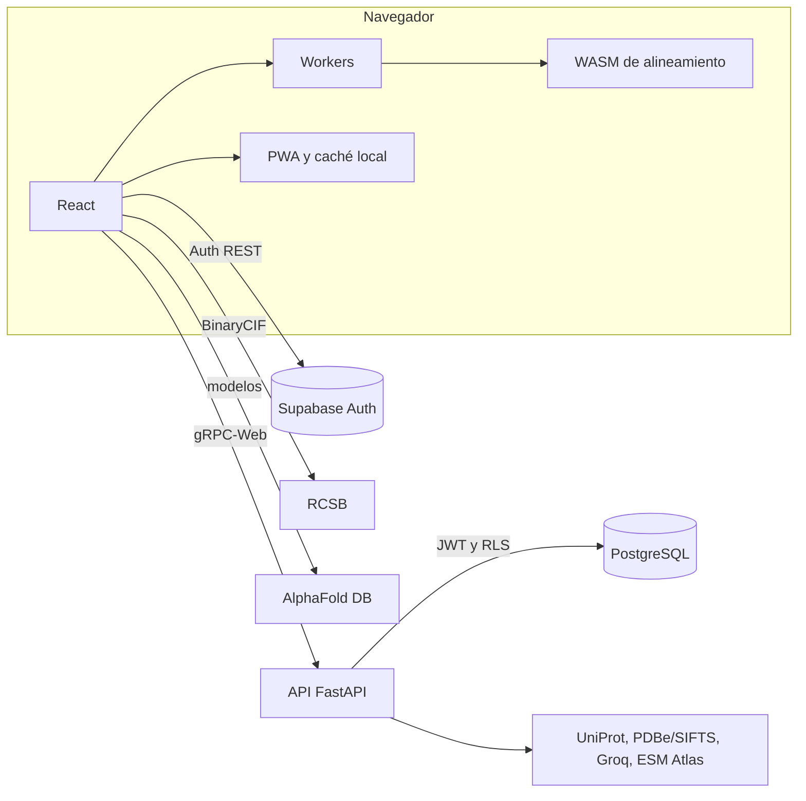

# ProteinForge — frontend

ProteinForge es un banco de trabajo web para analizar, comparar y diseñar secuencias de proteínas. Está pensado para estudiantes e investigadores que necesitan calcular propiedades de una secuencia, alinearla con otra, consultar su anotación y su estructura 3D y guardar el trabajo en una cuenta, sin instalar nada.

- Aplicación: <https://protein-forge.vercel.app>
- API: <https://protein-back.vercel.app> (repositorio [Jacklb19/Protein_Back](https://github.com/Jacklb19/Protein_Back))

Este repositorio contiene la interfaz web: React, Workers y un núcleo de alineamiento en Rust compilado a WebAssembly.

## Funcionalidades

| Herramienta | Qué hace |
|---|---|
| **Analizar** | Editor y FASTA con validación incremental; masa, pI, inestabilidad, índice alifático y GRAVY; perfil de hidropatía y propensiones; estructura con selección sincronizada |
| **Comparar** | Alineamiento global y local con el algoritmo de Gotoh (BLOSUM45/62/80, huecos afines) en Rust/WASM |
| **Biblioteca** | Catálogo de referencias, consulta de UniProt, 48 dominios ensamblables y visor 3D con Mol* |
| **Explorar** | Recorrido guiado por una proteína con su modelo de AlphaFold |
| **Diseñar secuencias** | Búsqueda reproducible de candidatos bajo condiciones de masa e hidropatía |
| **Laboratorio 3D** | Rediseños de una proteína con posiciones protegidas, comparación y, opcionalmente, predicción de estructura |
| **Proyectos** | Guardado en la cuenta, búsqueda, versiones, enlaces de solo lectura y guardado diferido sin conexión |
| **Informes y asistente** | PDF, JSON y CSV generados en el navegador; lectura en prosa de resultados ya calculados |

La interfaz está en español e inglés. Ni los descriptores ni las predicciones demuestran función biológica ni novedad experimental.

## Stack

| Área | Tecnología |
|---|---|
| Interfaz | React 19, TypeScript 6 (modo estricto), Vite 8, React Router 7 |
| Estructuras 3D | Mol* 5 |
| Comunicación con la API | Connect-Web 2 (gRPC-Web) y Protobuf-ES 2; validación con Zod 4 |
| Informes | jsPDF 4 |
| Cálculo | Web Workers y Rust 1.91 (wasm-bindgen) en `rust/alignment` |
| Aplicación sin conexión | `vite-plugin-pwa` |
| Pruebas | Vitest 5, Testing Library, Playwright 1.63 y axe-core |
| Entorno | Node.js 24 (`.nvmrc`) |

## Arquitectura



- El cálculo pesado (descriptores, alineamiento, búsqueda de candidatos, informes) corre en Workers dentro del navegador; las secuencias no se guardan en el almacenamiento del navegador.
- Los clientes gRPC-Web se generan desde los contratos `proto/` del backend (`src/gen/`, código generado que se versiona; `buf.gen.yaml` fija el commit del backend).
- El navegador envía a la API el token de sesión de Supabase; la API lo reenvía a PostgreSQL y las políticas RLS deciden qué filas se ven.
- La página usa COOP/COEP para los Workers paralelos y una CSP sin `unsafe-eval` (`vercel.json`).

## Estructura de carpetas

```text
src/
├── features/     # una carpeta por característica (analizar, alineamiento, biblioteca, proyectos…)
├── gen/          # clientes gRPC-Web generados desde el backend
├── i18n/         # catálogos es y en
├── shell/        # marcos público y de laboratorio, barra lateral, paleta de comandos
├── shared/       # componentes y utilidades comunes, rutas
├── theme/ preferences/ test/
rust/alignment/   # núcleo de alineamiento y paquete WASM versionado (pkg/)
e2e/              # pruebas de extremo a extremo con Playwright
scripts/          # medición, comprobación de PWA y WASM, utilidades de E2E
experiments/      # fuentes del cuaderno de rediseño con Colab
notebooks/        # cuaderno generado de Colab
public/           # fuentes locales y recursos de marca
docs/             # documentación técnica
```

## Puesta en marcha

Requisitos: Node.js 24 y npm. No hace falta Rust: el paquete WASM está versionado.

```bash
npm ci
cp .env.example .env   # opcional; ver la tabla siguiente
npm run dev
```

Vite sirve la aplicación en <http://localhost:5173>. Sin variables, la aplicación arranca pero las funciones con cuenta lo indican.

### Variables de entorno

Todas son públicas (llegan al navegador): nunca deben contener claves secretas, `service_role` ni contraseñas. Se fijan al construir, así que cambiarlas exige volver a desplegar.

| Variable | Obligatoria | Efecto |
|---|---|---|
| `VITE_SUPABASE_URL` | Para cuentas | URL del proyecto de Supabase |
| `VITE_SUPABASE_ANON_KEY` | Para cuentas | Clave pública (`sb_publishable_…` o `anon`) |
| `VITE_API_BASE_URL` | Para proyectos, UniProt y asistente | Origen de la API; sin ella no se hace ninguna petición a la API |
| `VITE_GENERATOR_HISTORY` | No | `enabled` activa guardar búsquedas del generador en Proyectos |
| `VITE_REPORT_STORAGE` | No | `enabled` activa guardar informes en la cuenta |
| `VITE_STRUCTURE_PREDICTION` | No | `enabled` activa la predicción desde el laboratorio |
| `VITE_PROJECT_CREATE_IDEMPOTENCY` | No | `enabled` reintenta creaciones de proyecto de resultado incierto |
| `VITE_PROJECT_LIVE` | No | `enabled` actualiza la lista de proyectos por el canal en vivo de la API |

Las banderas opcionales deben activarse solo contra una API que ya incluya la función. Ver [`.env.example`](.env.example) y [decisiones](docs/decisiones.md).

## Scripts

| Script | Qué hace |
|---|---|
| `npm run dev` | Servidor de desarrollo de Vite |
| `npm run dev:prediction` | Servidor local con la predicción activada (puertos propios, sin tocar `.env`) |
| `npm run build` | Comprobación de tipos y build de producción |
| `npm run preview` | Sirve el build de producción |
| `npm run lint` | ESLint |
| `npm run typecheck` | `tsc -b --noEmit` |
| `npm test` | Pruebas unitarias (Vitest) |
| `npm run test:coverage` | Pruebas unitarias con cobertura (mínimo del 70 %) |
| `npm run test:e2e` | Pruebas E2E con Playwright; admite `E2E_PORT`, `E2E_WORKERS` y `E2E_BROWSER` |
| `npm run check:pwa` | Comprueba el build sin conexión (`PWA_CHECK_PORT` cambia el puerto) |
| `npm run build:wasm` | Reconstruye el paquete WASM |
| `npm run build:wasm:linux` | Reconstruye el paquete WASM en Linux con Docker, como en CI |
| `npm run check:wasm` | Verifica que el paquete WASM versionado coincide con la reconstrucción |

## Pruebas y calidad

- Unitarias con Vitest y Testing Library, con cobertura mínima del 70 % (V8 no mide el código interno de Rust).
- E2E con Playwright en Chromium (también Firefox y WebKit con `E2E_BROWSER`), con auditorías de accesibilidad con axe, a 360 y 1280 px y en ambos temas. Ejemplo: `npm run test:e2e -- e2e/alignment.spec.ts`.
- CI (`.github/workflows`) ejecuta auditoría de dependencias, comprobación del código generado, tipos, lint, pruebas con cobertura, build, E2E críticos y, en el flujo de WebAssembly, formato y pruebas de Rust y reconstrucción reproducible del paquete WASM.
- Metodología y límites de las mediciones de rendimiento en [calidad y rendimiento](docs/calidad-y-rendimiento.md).

### WebAssembly

El toolchain de Rust está fijado en `rust-toolchain.toml` (1.91.1) con wasm-pack 0.15.0. El paquete que se versiona se construye en Linux (`npm run build:wasm:linux`), como en CI; una construcción en Windows funciona pero escribe rutas con `\` y no coincide byte a byte. `scripts/generate_alignment_references.py` regenera las referencias de prueba con Biopython (`requirements-reference.txt`).

## Despliegue

Dos proyectos de Vercel independientes, uno por repositorio, que publican desde `main`. El frontend usa el preset Vite (`npm run build`, salida `dist`). `vercel.json` define la reescritura de la SPA y las cabeceras de seguridad; si la API cambia de dirección, su origen exacto se añade a `connect-src`. Cuando un cambio afecta al contrato entre repositorios, el orden es migración, API y frontend. Detalles en [despliegue](docs/despliegue.md).

## Repositorio relacionado

La [API](https://github.com/Jacklb19/Protein_Back) (FastAPI, Python 3.14, Connect RPC y Supabase) es dueña de los contratos `proto/` y de las migraciones y las pruebas de RLS de PostgreSQL. Este frontend se puede clonar, probar y construir sin ella.

## Documentación

- [Requisitos](docs/definicion-proyecto.md) y [decisiones](docs/decisiones.md)
- [Pantallas](docs/pantallas.md), [diseño visual](docs/diseno-visual.md) y [fuentes](docs/font-provenance.md)
- [gRPC](docs/grpc.md) y [despliegue](docs/despliegue.md)
- [Proyectos](docs/projects.md), [biblioteca y estructuras](docs/references.md), [informes](docs/reports.md), [candidatos](docs/candidates.md) y [asistente](docs/assistant.md)
- [Laboratorio](docs/laboratory.md), [laboratorio de diseño](docs/laboratorio-diseno.md) y [predicción](docs/prediccion.md)
- [Segundo factor TOTP](docs/auth-totp-contract.md) y [Google OAuth](docs/google-oauth-publicacion.md)
- [Calidad y rendimiento](docs/calidad-y-rendimiento.md)
- [Anexo: definición original y evidencias de sprint](docs/archive/README.md)

## Licencia

MIT. Ver [LICENSE](LICENSE).
